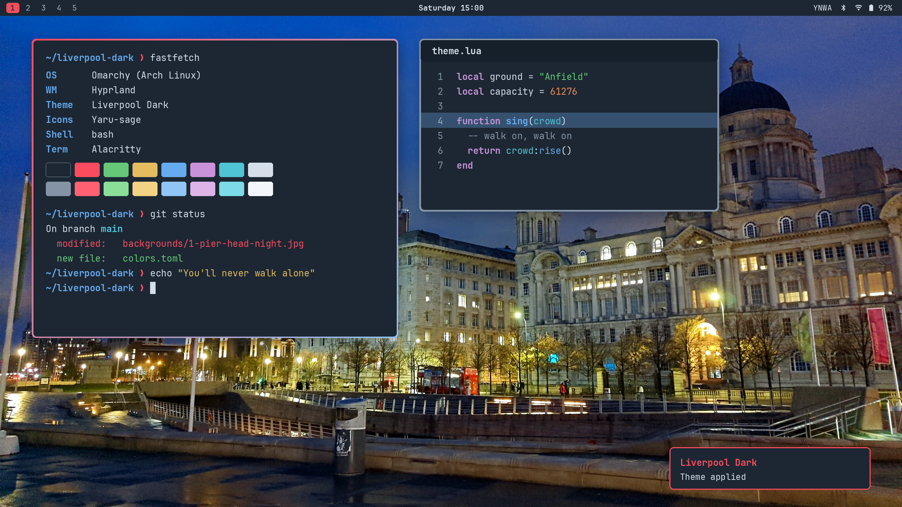

# Liverpool Dark

A dark [Omarchy](https://omarchy.org) theme in blue-grey stone and Mersey shadow, with bright matchday-red highlights. It is the dark companion to the Liverpool theme and uses the same seven photographs of Liverpool's waterfront and Anfield.



## Install

```bash
omarchy theme install https://github.com/dmcarrington/omarchy-liverpool-dark-theme
```

Reapply it later with:

```bash
omarchy theme set liverpool-dark
```

## Included

- `colors.toml`: the full palette. The active window border fades from red into blue.
- `icons.theme`: `Yaru-sage` icons.
- `backgrounds/`: seven 3840×2160 wallpapers. Cycle them with `omarchy theme bg next`.
- `preview.png`: the theme picker preview.
- `gtk-3.0.css` and `gtk-4.0.css`: optional blue-grey styles for GTK apps. Omarchy doesn't apply these automatically. To use them, copy each to `~/.config/gtk-3.0/gtk.css` and `~/.config/gtk-4.0/gtk.css`, then reopen your GTK apps. Remove the copies when you switch to another theme.

## Palette

| Role | Colour |
| --- | --- |
| Background | `#1c2733` blue-grey stone |
| Foreground | `#d6dfe9` moonlit stone |
| Accent | `#fa4c5e` matchday red |
| Selection | `#35516f` Mersey dusk |
| Blue | `#66abef` |
| Cyan | `#4fc4d4` |
| Green | `#65c777` |
| Yellow | `#e4bb5e` |
| Magenta | `#c992d9` |
| Brown | `#b48e70` |
